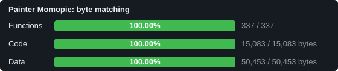

# Painter Momopie: matching decompilation

A work-in-progress **matching decompilation** of *Painter Momopie* (Game Boy, Japan; Sigma Enterprises, 1990): RGBDS assembly source that builds
the original 64 KiB ROM byte for byte, to be lifted step by step into named, structured, readable source. The long-term goal is a
native Windows and Linux port.

This repository contains no game files. You need your own copy of the ROM.

| | |
|---|---|
| ROM | 65,536 bytes, MBC1, 4 banks of 16 KiB (SHA-1 in `orig/README.md`) |
| Code found so far | 327 routines (121 named), about 14.5 KB traced as code (22 % of the ROM); every instruction the game executed in play tests is covered; the rest is data (`INCBIN` of your ROM) |
| Native build | a static recompilation to C plays the game on Windows with video, input and sound (`port/`, `tools/recomp.py`) |
| Byte identity | the generated sources reproduce all 65,536 bytes (proved by `tools/gb_dis.py --check`) |
| Assembler | RGBDS (rgbasm, rgblink) |

The percentages in the ByteMatch report count **byte-exact assembly source**. Decoded instructions and `db` blobs both count as
matching, so the numbers start high. The remaining work is readability: names, structured data, constants, commented routines.
Open tasks are in `REVERSE.md`.



## What "100%" means here

The project is a disassembly in RGBDS assembly, not C. The ROM rebuilds byte for byte from `src/` plus the assets extracted from your own ROM,
so the progress report counts every routine and data region as matched. That number measures reproduction of the bytes, not understanding:
the work that continues after it (naming routines and variables, comments, editable text forms for data, removing hardcoded addresses) is
documentation and tooling. Names marked "provisional" in `labels.csv` and `src/constants.inc` are guesses from the code; a few dozen routines and
many RAM addresses are still unnamed, and some data regions are still raw bytes.

## Building

```
# put your ROM at orig/painter_momopie.gb, then
python tools/build.py              # RGBDS 0.9+ (PATH, RGBDS_DIR or --rgbds DIR); prints OK when byte-identical
python tools/gb_dis.py --check    # no RGBDS needed: the in-repo reference assembler rebuilds every byte
python tools/gb_dis.py --write    # regenerate src/bank_NN.asm and extract assets/ from the ROM (resets any edits)
python tools/report.py            # write progress/jp/report.json
```

## Layout

| Path | Contents |
|---|---|
| `src/` | RGBDS sources: instructions and labels; data is `INCBIN` of files in `assets/` |
| `assets/` | data extracted from your own ROM (git-ignored): editable PNG tile sheets, text forms of maps, spawns and balance tables, raw `.bin` for the rest; see `docs/MODDING.md` |
| `labels.csv`, `seeds.csv` | names and code entry points, fed to the disassembler |
| `config/functions.tsv` | routine list used by the progress report |
| `tools/` | SM83 table and encoder, tracing disassembler, headless interpreter with screenshots (`emu.py`), static recompiler to C (`recomp.py`), report generator, ROM checker |
| `port/` | runtime and drivers for the recompiled game (native Windows/Linux port in progress); `port/logic.c` holds hand written C versions of over 200 routines (play mode, enemies, scoring), checked frame by frame with `tools/lift_check.py` |
| `REVERSE.md`, `dead_ends.md`, `docs/` | findings, task list, notes |
| `progress/jp/report.json` | the objdiff-format report ByteMatch reads |

## Playing it natively (Windows)

```
python tools/gb_dis.py --write                                   # once: extract src/ and assets/ from your ROM
python tools/build_port.py --rgbds E:\rgbds --cc path\to\clang.exe   # builds build/recomp/game_win.exe with the data inside
build\recomp\game_win.exe                                          # no ROM file needed any more
```

Arrows = D-pad, Z = A, X = B, Enter = Start, Right Shift = Select, F11 = fullscreen, Esc = quit, P = pause, M = mute, F2 = palette, Tab = fast forward. The generated C is derived from the game and is not committed.

## Progress report and CI

`progress/jp/report.json` is generated locally (`python tools/report.py`) and committed. `.github/workflows/report.yml` uploads it
as the artifact `jp_report` on every push to `master`, which is what [ByteMatch](https://bytematch.dev/) reads. It holds only
names, addresses, sizes and percentages. `.github/workflows/build.yml` (manual) rebuilds and verifies on a self-hosted runner
with the label `rgbds`; set the repository variable `ROM_ORIG_PATH`.

## Contributing

Read `AGENTS.md`. No game files in git; names stay address-based until the meaning is certain.

## License

MIT, see `LICENSE` (covers the tools and the source written for this project; the game belongs to its rights holders).
