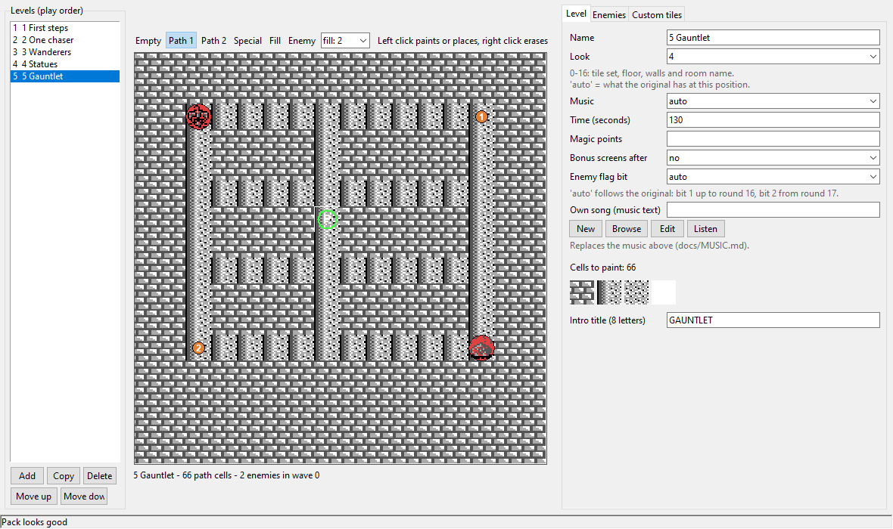
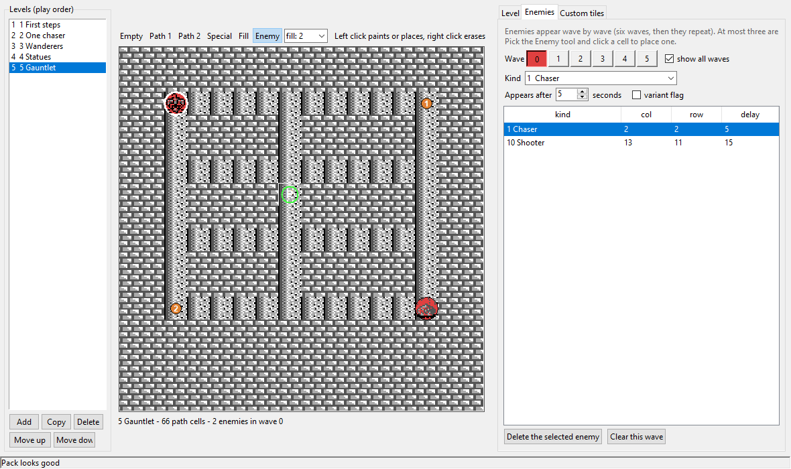
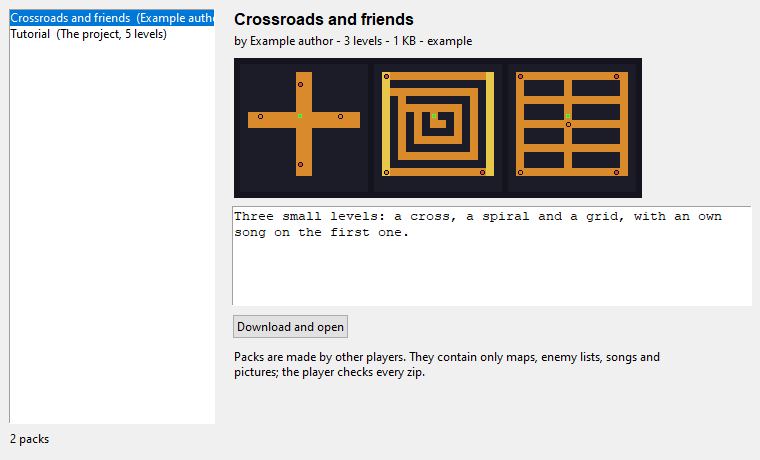
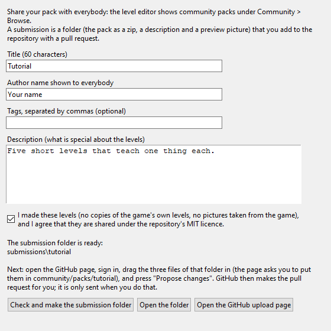
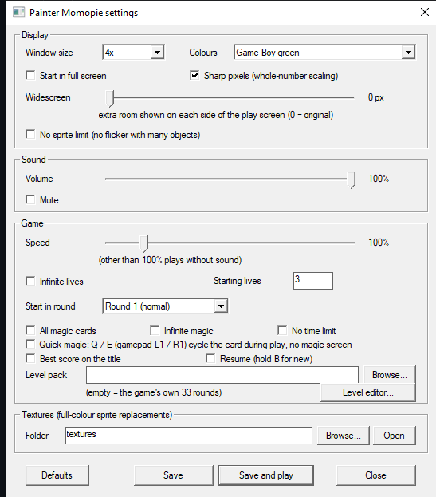

# Painter Momopie: decompilation, native PC port and level editor

A matching **decompilation** of *Painter Momopie* (Game Boy, Japan; Sigma Enterprises, 1990), a **native Windows port** that runs without an emulator, and a set of **modding tools**:
a point-and-click level editor, custom textures, music, level packs and a community pack browser.

The RGBDS assembly source rebuilds the original 64 KiB ROM byte for byte. A static recompiler turns it into C, and about 300 routines have been rewritten by hand in readable C
and checked frame by frame against the original. This repository contains **no game files**: you need your own copy of the ROM to build and play (see below).


## Quick start (Windows): `build.bat`

1. Put your own copy of the ROM (a `.gb` file; the Japanese original, SHA-1 `193901223ffc89cf4f42a19e57447249affcc843`) in the same folder as `build.bat`.
2. Install [Python 3.9 or newer](https://www.python.org/downloads/) once (tick *Add python.exe to PATH* and keep *tcl/tk*).
3. Double-click `build.bat`. The first run downloads RGBDS and, if you have no C compiler, a portable one (about 190 MB) into `.buildtools/`, checks every download against a fixed checksum,
   and rebuilds everything from your ROM.

You get a folder `PainterMomopie/` with `game_win.exe` (the game), `settings.exe` (all options), `level_editor.exe`, the example and tutorial level packs, textures and docs. It contains data from
your ROM, so it is for your own use only: do not publish it.

## What you get

Everything is optional and **off by default**: the game plays exactly like the Game Boy original until you switch something on.

### A level editor that needs no Python

`level_editor.exe` is a point-and-click editor for new levels: paint the map, place enemies in up to six waves, pick the look, music, time and intro title of each level, reorder the levels,
and press **F6** to play it. While the test window is open, saving restarts it on your change. Levels live in text `.pmpack` files that can be zipped and shared.





*The editor draws the real room tiles and enemy pictures from your own copy of the ROM (without it, flat colours).*

- Per-level and per-pack **custom tiles**: repaint floors, walls, enemies or the player in full colour for one level only (a Halloween level, say).
- **Custom music** in a small text language, played by the game's own sound engine (the editor has New / Edit / Listen buttons).
- Undo and redo, mirror, flood fill, random mazes, an automatic **pack check** that finds levels which can never be cleared, and a `tools/pack_check.py` that plays every level with random input.
- A tutorial pack (`packs/tutorial.pmpack`) and a ten minute guide: [docs/TUTORIAL.md](docs/TUTORIAL.md).

### Community level packs

*Community* menu: browse packs made by other players with a preview of the maps and a description, download one with a click, or submit your own. Submissions are plain pull requests to this
repository (`community/packs/`): the editor checks the pack, makes the submission folder, and opens GitHub's upload page, so nothing is sent until you finish it yourself. Details and rules:
[docs/COMMUNITY.md](docs/COMMUNITY.md).





### A settings window for everything

`settings.exe` edits `painter_momopie.ini` and starts the game.



### More about the native player

| Feature | Details |
|---|---|
| **Widescreen** and **no sprite limit** | see more of the room (up to 240 pixels wide) and play without the flicker of the Game Boy's 40 sprite limit |
| **Full-colour textures** | replace any tile with a PNG: sprites, floors, fonts, the title logo. Reload with F5 while the game runs. [docs/TEXTURES.md](docs/TEXTURES.md) |
| Paint a whole character | `tools/sprite_sheet.py` assembles every frame of the player into one picture and splits your painting back into tiles. [docs/SPRITES.md](docs/SPRITES.md) |
| Palettes and filters | Game Boy green, grey, sepia, a colour-blind friendly blue and yellow, or your own four colours; scanline and LCD-grid filters |
| **Quick magic** | cycle the magic cards with Q / E or the shoulder buttons during play instead of using the menu (the original menu still works) |
| Practice options | infinite lives, start lives, start in any round, all magic cards, infinite magic, no time limit, 50-400 % speed, fast forward (Tab) |
| Best score and resume | a high score on the title screen and continue from the last round reached (hold B for a new game) |
| Remap keys and gamepad buttons | in the ini; the gamepad works with D-pad or stick |
| **Replays** | `--record` and `--replay` store and replay a run exactly (the game is deterministic) |
| Replace the game's own songs | put `song_81.mml` ... in a folder (`music_folder`) |
| Translating and fonts | the text is tile graphics; [docs/FONTS.md](docs/FONTS.md) lists which tile is which letter |
| Level packs as `.zip` | the player loads a zipped pack (pack, textures and songs) directly |

All options are in [docs/CONFIG.md](docs/CONFIG.md).

## Status of the decompilation

| | |
|---|---|
| ROM | 65,536 bytes, MBC1, 4 banks of 16 KiB (SHA-1 in `orig/README.md`) |
| Routines | 344 found and named; 294 rewritten as hand-written C, the rest are vectors, tables and routines folded into those (`tools/lift_status.py`); every data table is named |
| Byte identity | the sources reproduce all 65,536 bytes (proved by `tools/gb_dis.py --check` and the RGBDS build) |
| Native build | a static recompilation to C plays the game on Windows with video, input and sound (`port/`, `tools/recomp.py`); an SDL2 front end for Linux and macOS exists but has not been run yet |
| Assembler | RGBDS (rgbasm, rgblink) |

The percentages in the ByteMatch report count **byte-exact assembly source**. Decoded instructions and `db` blobs both count as
matching, so the numbers start high. The remaining work is readability and testing on other platforms. Open tasks are in `REVERSE.md`.

## What "100%" means here

The project is a disassembly in RGBDS assembly, not C. The ROM rebuilds byte for byte from `src/` plus the assets extracted from your own ROM,
so the progress report counts every routine and data region as matched. That number measures reproduction of the bytes, not understanding:
the work that continues after it (naming routines and variables, comments, editable text forms for data, removing hardcoded addresses) is
documentation and tooling. Every routine and every data table has a name chosen from what the code does (animation tables are named by the enemy kind that uses them and their number in the set); some RAM fields
are still described only as "purpose unknown, only copied with the record", and some data regions are still raw bytes.

## Building

```
# put your ROM at orig/painter_momopie.gb, then
python tools/build.py              # RGBDS 0.9+ (PATH, RGBDS_DIR or --rgbds DIR); prints OK when byte-identical
python tools/gb_dis.py --check    # no RGBDS needed: the in-repo reference assembler rebuilds every byte
python tools/gb_dis.py --write    # regenerate src/bank_NN.asm and extract assets/ from the ROM (resets any edits)
python tools/report.py            # write progress/jp/report.json
```

## Layout

| Path | Contents |
|---|---|
| `src/` | RGBDS sources: instructions and labels; data is `INCBIN` of files in `assets/` |
| `assets/` | data extracted from your own ROM (git-ignored): editable PNG tile sheets, text forms of maps, spawns and balance tables, raw `.bin` for the rest; see `docs/MODDING.md` |
| `labels.csv`, `seeds.csv` | names and code entry points, fed to the disassembler |
| `config/functions.tsv` | routine list used by the progress report |
| `tools/` | SM83 table and encoder, tracing disassembler, headless interpreter with screenshots (`emu.py`), static recompiler to C (`recomp.py`), report generator, ROM checker |
| `port/` | runtime and drivers for the recompiled game (native Windows port, SDL2 front end for Linux and macOS); `port/logic.c` holds hand written C versions of 294 routines (play mode, enemies, scoring, sound, ending, link); the rest are vectors, tables and routines folded into those (`tools/lift_status.py`), checked frame by frame with `tools/lift_check.py` |
| `REVERSE.md`, `dead_ends.md`, `docs/` | findings, task list, notes |
| `progress/jp/report.json` | the objdiff-format report ByteMatch reads |

## Playing it natively (Windows)

```
python tools/gb_dis.py --write                                   # once: extract src/ and assets/ from your ROM
python tools/build_port.py --rgbds E:/rgbds --cc path/to/clang.exe   # builds game_win.exe, settings.exe and game_headless.exe in build/recomp/
python tools/build_editor.py                                     # level_editor.exe (needs pip install pyinstaller pillow)
python tools/package.py                                           # a ready-to-use folder dist/PainterMomopie/ with the game, settings, editor and packs, for your own use
build/recomp/game_win.exe                                          # no ROM file needed any more
```

The game and settings executables contain the game's data, so they are for your own use and are never committed or published. `level_editor.exe` contains none: a toolkit zip
with the editor, settings window, docs and example packs is published from `.github/workflows/release.yml`. Run `settings.exe` (next to the player) for a
window with every option; the same options live in `painter_momopie.ini`.

Arrows = D-pad, Z = A, X = B, Enter = Start, Right Shift = Select, F11 = fullscreen, Esc = quit, P = pause, M = mute, F2 = palette, F5 = reload textures,
F12 = screenshot, Tab = fast forward. Keys and gamepad buttons can be changed in the ini (`[keys]`).

## Documentation

[CONFIG](docs/CONFIG.md) options and controls, [LEVELS](docs/LEVELS.md) the editor and the pack format, [TUTORIAL](docs/TUTORIAL.md) your first level,
[COMMUNITY](docs/COMMUNITY.md) sharing packs, [TEXTURES](docs/TEXTURES.md), [SPRITES](docs/SPRITES.md) and [FONTS](docs/FONTS.md) for pictures and translations,
[MUSIC](docs/MUSIC.md) custom songs, [MODDING](docs/MODDING.md) and [PORTING](docs/PORTING.md) for how the port works.

## Progress report and CI

`progress/jp/report.json` is generated locally (`python tools/report.py`) and committed. `.github/workflows/report.yml` uploads it
as the artifact `jp_report` on every push to `master`, which is what [ByteMatch](https://bytematch.dev/) reads. It holds only
names, addresses, sizes and percentages. `.github/workflows/build.yml` (manual) rebuilds and verifies on a self-hosted runner
with the label `rgbds`; set the repository variable `ROM_ORIG_PATH`.

## Contributing

Read `AGENTS.md`. No game files in git; names stay address-based until the meaning is certain.

## License

MIT, see `LICENSE` (covers the tools and the source written for this project; the game belongs to its rights holders).
